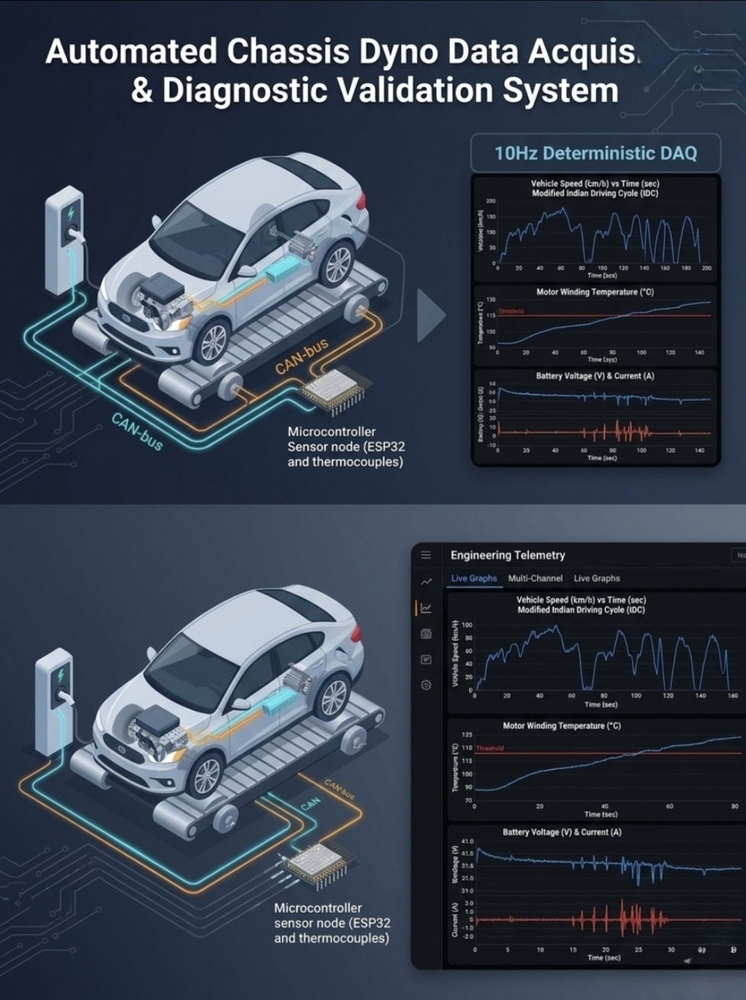

# chassis-dyno-daq-validation-system


# Automated Chassis Dyno Data Acquisition & Diagnostic Validation System

## Overview
An end-to-end Data Acquisition (DAQ), telemetry logging, and automated diagnostic validation framework designed for **ICE and Electric Vehicle (EV) powertrain testing** on a chassis dynamometer. 

This system bridges peripheral vehicle instrumentation (temperature, current, voltage) with OBD-II / CAN-Bus ECU telemetry, executes standardized drive cycles (Indian Driving Cycle - IDC), detects real-time threshold faults, and generates automated post-test validation reports.

## Key Features
* **Multi-Channel DAQ:** Synchronizes external sensor data (K-Type Thermocouples, Hall-Effect Current Sensors) with vehicle CAN-Bus frames.
* **Drive Cycle Simulation:** Simulates speed-vs-time load profiles (IDC) to evaluate powertrain thermal and electrical stability.
* **Real-Time Fault Diagnostics:** Flags thermal runaway, battery voltage sag, and RPM anomalies during live test runs.
* **Automated Reporting & SOPs:** Exports structured CSV logs, generates visual performance plots, and includes standardized pre-test calibration checklists.

## System Architecture
`[Vehicle ECU / OBD-II + Peripheral Sensors]` ➔ `[ESP32 + MCP2515 CAN Node]` ➔ `[Python DAQ Pipeline]` ➔ `[Fault Engine & Automated Report]`

## Hardware Stack
* **Microcontroller:** ESP32 / Arduino Uno
* **CAN Transceiver:** MCP2515 CAN Bus Module + OBD-II to DB9 Interface
* **Thermal Sensor:** MAX6675 + K-Type Thermocouple (Exhaust / Motor Housing Temp)
* **Current Sensor:** ACS712 Hall-Effect Sensor (EV Battery Pack Current Draw)

## Quick Start
1. **Flash Firmware:** Upload `firmware/can_sensor_daq_node.ino` to your ESP32/Arduino.
2. **Install Dependencies:**
   ```bash
   pip install -r requirements.txt
   ```
3. **Run Simulation Mode (No Hardware Required):**
   ```bash
   python src/drive_cycle_simulator.py
   ```
4. **Run Live Hardware DAQ Logger:**
   ```bash
   python src/daq_logger.py --port COM3
   ```
5. **Generate Validation Report:**
   ```bash
   python src/report_generator.py
   ```

   
```
chassis-dyno-daq-validation-system/
├── README.md
├── requirements.txt
├── config/
│   └── test_thresholds.json
├── firmware/
│   └── can_sensor_daq_node.ino
├── src/
│   ├── daq_logger.py
│   ├── drive_cycle_simulator.py
│   └── report_generator.py
└── docs/
    └── SOP_Chassis_Dyno_Testing.md

```
